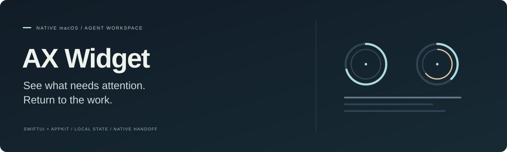
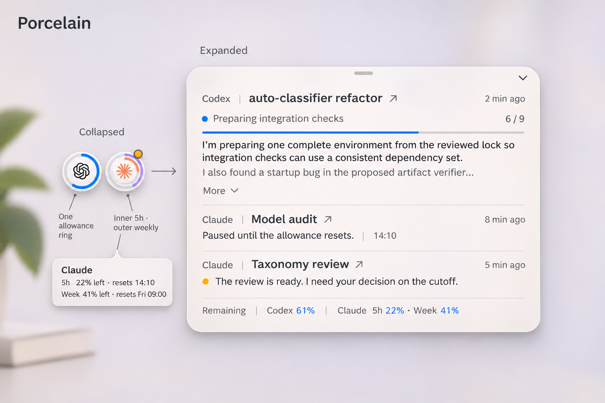

# AX Widget

[](https://github.com/EssenceSentry/ax-widget/actions/workflows/macos.yml)
[](Package.swift)

**Keep an eye on agent work without reopening every conversation.** AX Widget puts Claude and Codex allowance, recent updates, and running jobs in a small native Mac interface. Expand it to read the context, then return to the original app or attach to the running command.

**[Watch a job reattach →](https://github.com/EssenceSentry/ax/blob/main/docs/reattach.md)** · [Build and preview](#build) · [Explore ax](https://github.com/EssenceSentry/ax)

- **Useful at a glance.** Compact provider rings expand into conversation updates and task progress.
- **A route back to the actual work.** Native conversation links and Terminal reattachment connect the summary to its source.
- **A native companion.** SwiftUI, AppKit, and a real WidgetKit extension support floating and system-widget surfaces. Background refresh reads local state without model calls.



With the [build prerequisites](#build) installed, run `swift run AXWidget --demo --expanded` for synthetic conversations. Carbon, Porcelain, and Frost share the same layout; system appearance is the default. The floating app and WidgetKit extension have separate build requirements.

## Floating mode

- Codex has one remaining-allowance ring. Claude's inner ring shows five-hour
  allowance and the outer ring shows weekly allowance.
- Hover for percentage remaining, reset time, and observation age.
- Click the menu-bar icon or the small system widget to open the expanded panel.
  Right-click the menu-bar icon for options. **Keep floating** is off by default:
  closing the panel hides both windows. Enable it to keep the tiny usage pill
  visible while closed; explicit existing preferences are preserved. Its pin
  control sits immediately to the left of the new-conversation buttons.
- Drag either provider ring to move the pill. When the conversation panel is open,
  you can also drag its top grip. Both windows follow the pointer together.
  Click either ring to toggle the panel. Click outside or press Escape to close.
  The widget remembers its position across launches.
- Conversations are sorted by actual message, reasoning, tool, or active-job activity,
  limited to the last 12 hours. Opening a chat, changing its settings, or refreshing
  usage does not count as activity. Unpinned chats need a recorded activity timestamp;
  provider metadata alone cannot make an old chat recent.
  Use the pushpin beside a title to keep that conversation in the widget after
  12 hours. Saved conversations remain first, in pin order, followed by up to
  eight other recent chats. Widget pins persist across restarts and have no
  three-window limit. Pinning to the widget requires no Accessibility permission
  and does not open or arrange a provider window.
  When Claude continues a Desktop chat under a new CLI session ID, the widget
  follows its registered prior-session IDs and shows one conversation. Widget
  pins, window-group membership, and active jobs follow that same chat. Separate
  chats with the same title remain separate.
- The expanded panel shows the latest original agent prose, not tool logs or an
  invented summary. **More** appears only when the rendered preview actually
  clips content, and expands the text in place. The panel grows and shrinks
  with its content; scrolling begins only at the available screen height.
- Updates render native Markdown: bold, italics, links, headings, lists, code
  blocks, and wrapping tables. Internal memory-citation markup is hidden.
- Rendered prose uses regular text with medium-weight emphasis, headings, and table
  headers. Permanent titles, labels, controls, and usage figures retain their weight.
- Numeric progress comes from ax tasks. Reaching a task total does not imply
  that the conversation is complete.
- Each conversation has a separate numbered badge for its active ax jobs, even
  while a numeric progress counter is visible. If any active job has numeric
  progress, the most recent such counter stays visible alongside the total job count.
- **New Codex** and **New Claude** open a native new-chat composer using the most
  recent working folder for that provider. Opening the composer sends no prompt.
- A blue provider dot marks a pending question, in the floating pill and the
  small system widget. The expanded panel shows one question at a time, with
  previous/next arrows and a position counter. Choices and typed drafts are kept
  while navigating. A text field is included where allowed. **Send answer**
  submits the selected response to that same
  conversation. Once delivery succeeds, the answered questions disappear immediately.
  The next pending question stays available, and the indicator clears after the last answer.
  When Codex finishes or interrupts a turn, the widget also removes any unanswered
  questions from that turn on the next refresh.
  A failed send keeps the draft. An unconfirmed send asks you to check the conversation.
  When an agent asks several questions together, fill them in and use **Send answers**.
  Clicking the text field clears the selected choices. The send button appears
  only once the required answers have a selection or nonempty text.
- Claude handles inline answers in its native question form. Codex uses its
  local reply connection when available. If it is disconnected, AX Widget can
  send the selected option or your own text through the live question card.
  It checks that the original chat received the exact answer. Native form access requires macOS Accessibility permission.
  Choose **Enable window control and question replies…** from the menu-bar menu or the question form
  to request access, then enable **AX Widget** in macOS Accessibility settings.
  Background refresh never requests permission. Answers submitted in Claude
  clear from the widget when its native tool-result record is saved.
- Idle Codex keeps its last observed allowance until that allowance resets.
  After five minutes without a fresh observation, a small clock and a dimmer
  continuous ring mark the cached reading; hover for its age and reset time.
  Freshness validation remains separate from this display cache.
- AX Widget refreshes Claude's five-hour and weekly allowances with its built-in
  quota command as their observations age. A fresh 0% used reading can have no
  scheduled reset. Unknown, unavailable, expired, and stale readings show a neutral track and an em dash.
- All rings use continuous strokes. The supplied OpenAI and Claude SVG marks stay
  vector artwork; OpenAI adapts to the selected appearance.
- The menu-bar icon is a pure-white axe silhouette. Right-click it to control Keep floating,
  appearance, refresh, and quit.

## Conversation window group

Use the overlapping-windows icon beside a title to add up to three conversations
to a window group. This opens that exact conversation in its own native Claude or
Codex window and arranges the group side by side on the widget's display. Claude uses its compact, sidebar-free
conversation pop-outs. Codex uses separate native windows with the conversation
sidebar collapsed (its slim navigation rail remains). The separate toolbar pin still means
**Keep floating**; it does not pin a conversation.

- **Show group** (overlapping rectangles) restores and raises all grouped windows
  with one click. It is available in the expanded panel, the floating pill when
  enabled, and the menu-bar menu. Switch to Slack or any other app normally;
  click Show group when you want all the conversations back.
- **Minimize group** minimizes only the grouped windows. Other windows belonging
  to Claude and Codex are left alone.
- **Arrange side by side** is in the group button's context menu and menu-bar
  menu. Normal Show group preserves any positions and sizes you adjust manually.
  Membership changes arrange the group again. If the apps' minimum window sizes do not
  fit, the previous frames are restored and the panel explains the problem.
  Layout adapts to different native minimum widths instead of assuming equal minima.
- Close a grouped window in Claude or Codex to take it out of the split. Two
  remaining windows share their display side by side. A single remaining window
  fills the usable desktop. Minimizing a window keeps it in the group. The
  pushpin that saves the conversation in the widget works independently.
- Removing a window from the group maximizes it on its current display, then
  rearranges and raises the remaining group in front of it. Maximizing fills the
  usable desktop area, respecting the Dock and menu bar, without entering a
  full-screen Space. A closed window stays closed. Its widget pin is unchanged;
  unpinning from the widget does not remove its window from the group.
  Both selections survive widget restarts. Restoring group references never
  launches provider apps until you request Show group. No chat contents are stored
  in preferences.
- Upgrading from the original combined control preserves existing selections as
  both widget pins and window-group members. Subsequent changes are independent.
  The menu-bar menu has separate **Pinned to widget** and **Grouped windows** lists.

These are ordinary app windows, without an always-on-top level. Group control
requires macOS Accessibility access for AX Widget. It uses native conversation
navigation and Open in New Window actions; it sends no prompts, creates no
conversations, and does not interrupt running agents. Ambiguous or unavailable
window targets produce an error rather than selecting another conversation.
Claude's main window exposes its session URL. Its compact pop-outs expose the registered
chat title on the window and its document, or a return-to-main-window control on older versions.
Codex also exposes a native title. AX Widget
checks titles against the corresponding provider's local registration/history and
accepts only unique matches; duplicate titles must be renamed before pinning.
Use ordinary desktop windows on one display; leave full screen before arranging.

The arrow beside a grouped chat raises the whole split and preserves its layout.
The arrow beside another chat opens that conversation outside the split. Adding a
chat to the split reuses its existing Codex window or moves it into a compact
Claude pop-out. AX Widget closes a verified duplicate regular view after the split
is ready. If the app cannot safely close that view, the panel tells you.

## Notification Center and desktop widget

The app contains one small WidgetKit usage widget: two provider icons, continuous
remaining-allowance rings, and compact percentages. Claude's five-hour percentage
uses the inner-ring color; its weekly percentage uses the outer-ring color.
There are no repeated provider names or reset-time rows. Hover a ring for details.
After launching the installed app, open Notification Center, choose Edit Widgets,
and search for **AX Widget**. The same widget can be placed on the desktop.
Conversation updates live in the floating panel; there is no large system widget.
Floating mode can be hidden independently.

The floating and menu-bar indicators update with the local reader. Pending-question
changes request an immediate system-widget reload; macOS still controls when a
Notification Center widget renders the new snapshot.

Claude and Codex can both be closed while AX Widget runs. It reads their saved
local histories and keeps the last available updates; clicking a conversation or
new-chat action launches its provider app. It never launches an agent just to
refresh a view. Idle Codex readings remain visible as cached until their recorded
reset. Expired or unavailable allowances stay unknown.

The widget reads a private snapshot written by the app; keep the app running for
new data. macOS controls its refresh timing, so it is a glanceable snapshot.
Hover for reset and observation details. Click the usage widget to open the floating
conversation panel. Conversation titles there open their exact provider chat;
they never submit a prompt.

The local-development extension has a narrow read-only sandbox exception for
`~/Library/Application Support/ax-widget/`. It cannot read provider histories or
modify ax state. An App Store distribution would replace this development bridge
with a provisioned App Group. No Apple signing identity or notarization is claimed.

## Build

Runs on macOS 14+. Building requires the macOS 26 SDK (Xcode 26 or newer),
Swift 6+, and installed ax for usage snapshots. Full system widgets require
Xcode and [XcodeGen](https://github.com/yonaskolb/XcodeGen).

```sh
swift test --jobs 2
scripts/build.sh
scripts/install.sh
```

If Swift Testing reports that it cannot find the `TestingMacros` plugin with Command Line Tools selected, load the bundled macro explicitly:

```sh
plugin="$(xcode-select -p)/usr/lib/swift/host/plugins/testing/libTestingMacros.dylib"
swift test --jobs 2 -Xswiftc -load-plugin-library -Xswiftc "$plugin"
```

With Command Line Tools alone the build script produces the floating app.
With full Xcode and XcodeGen it builds and embeds the real widget extension.
The macOS CI workflow builds both and uploads an ad-hoc-signed app ZIP. This is a
local developer build, not a notarized public release.

For local development, a persistent **AX Widget Local Signing** certificate in
the login Keychain lets successive builds keep the same signing identity.
`scripts/setup-local-signing.py` prints the proposed Keychain changes without
making them; `--install` creates the identity after explicit approval. The
certificate is trusted only for code signing on this Mac, with no Apple account
or cloud copy of its private key. Builds and installations automatically reuse
it; `AX_WIDGET_SIGNING_IDENTITY` can select another identity. CI uses ad-hoc
signing. Moving from ad-hoc signing to the certificate requires a fresh
Accessibility grant; later updates retain the same designated requirement.

For design inspection without live histories:

```sh
swift run AXWidget --demo --expanded
swift run AXWidgetRender build/previews
```

Demo mode is labeled, never opens synthetic conversations, and never overwrites
the live widget snapshot. The renderer produces native SwiftUI previews of all three
appearances in the floating and small-widget layouts, plus a Markdown sample;
these are not evidence of system-widget hosting.

## Local data

The app lists active, registered Codex chats from the native thread database.
It selects interactive CLI, Desktop and VS Code chats before applying the display
limit. Headless runs and delegated workers stay out of the list. The widget lists
Claude chats registered for the active Desktop account and organization. Desktop's
archive and deletion records apply to pinned chats too. The ax catalog supplies
transcript paths for those registrations. The app queries ax
tasks through its local socket and reads recent transcript tails for prose.
Question cursors start at the latest Codex turn and retain its unanswered questions
through lengthy tool output until a reply, completion, or interruption. Existing conversation
files are watched for changes, coalesced over 200 milliseconds, with a four-second
discovery/fallback poll. A separate queue reads `ax usage` once per minute. When Claude's
observation approaches five minutes, the widget requests `ax usage --refresh`.
Failed quota requests are spaced at least three minutes apart.
Reads are performed off the main thread. Shared snapshots have owner-only permissions.

Eligible CLI and VS Code conversations appear in the widget once ax registers
them while Claude Desktop is fully quit. A saved pin becomes visible again if
its conversation returns to Desktop.

Background refresh makes no model calls and sends no messages. Opening a native
new-chat composer is not a model turn. Sending an answer is an explicit user
action and can resume that conversation. The widget creates no ax tasks or alarms,
and has no notification service, HTTP server, Cloudflare, or analytics.
The approved concept images in [docs/design](docs/design) are illustrative design
references, not screenshots of shipped behavior. Provider names and icons belong
to their respective owners; this is an independent local companion.
